# Mobile Bot Advanced

**Intern:** Adithya S
**Stack:** ROS 2 Humble · Ubuntu 22.04 LTS · Gazebo · RViz2 · SLAM Toolbox · OctoMap · Nav2

## Contents
1. [Workspace Setup](#workspace-setup)
2. [Map a Custom World](#map-a-custom-world)
3. [Fuse 2D LIDAR and Depth Camera](#fuse-2d-lidar-and-depth-camera)
4. [Autonomous 2D Navigation](#autonomous-2d-navigation)
5. [Multi-Waypoint Navigation](#multi-waypoint-navigation)

## Repository Layout
```
Mobile_Bot_Advanced/
├── docs/images/                      # screenshots and GIFs used in this README
└── src/
    ├── adv_tortoisebot/              # xacro robot, worlds, maps, Nav2 config, launch files, nodes
    │   └── launch/
    │       ├── gazebo.launch.py                    # Gazebo + robot (included by the others)
    │       ├── display.launch.py                   # RViz2 + robot_state_publisher
    │       ├── map_custom_world.launch.py          # Map a Custom World
    │       ├── fuse_lidar_depth_camera.launch.py   # Fuse 2D LIDAR and Depth Camera
    │       ├── autonomous_navigation.launch.py     # Autonomous 2D Navigation
    │       ├── multi_waypoint_navigation.launch.py # Multi-Waypoint Navigation
    │       └── octomap_launch.xml                  # OctoMap mapping (used by the fusion launch)
    └── my_bot_sim/                   # support package used by map_custom_world.launch.py
```
`map_custom_world.launch.py` loads its robot URDF, world, SLAM config and RViz launch from the `my_bot_sim` package, so both packages are built together.

## Workspace Setup
Install the dependencies once:
```bash
sudo apt install ros-humble-ros-gz ros-humble-gazebo-ros-pkgs ros-humble-ros2-control ros-humble-ros2-controllers \
                 ros-humble-xacro ros-humble-slam-toolbox ros-humble-navigation2 ros-humble-nav2-bringup \
                 ros-humble-octomap ros-humble-octomap-mapping ros-humble-octomap-server \
                 ros-humble-laser-geometry ros-humble-teleop-twist-keyboard ros-humble-rviz2
```
Clone, build and source:
```bash
git clone <your-repo-url> Mobile_Bot_Advanced
cd Mobile_Bot_Advanced
colcon build
source install/setup.bash
```
Run `source install/setup.bash` in every new terminal.

---

## Map a Custom World
Map a custom Gazebo world with 10+ obstacles using the 2D LIDAR on the TortoiseBot and SLAM Toolbox.

**Launch file:** `map_custom_world.launch.py`

### Step-by-step
1. **Reuse the existing workspace**, which already has the launch files for RViz and Gazebo with `robot_state_publisher`.
2. **Configure the robot model.** Make sure the robot has the LIDAR plugin. The URDF was converted to xacro, with a separate `lidar_sensor.xacro` included in `tortoise_bot.urdf.xacro`.
3. **Design the custom world.** `custom_obstacle_world.world` was built in the Gazebo Model Editor with 10+ unique obstacles (cylinders, cubes, barriers and props) so the LIDAR rays have many surfaces to reflect from.

   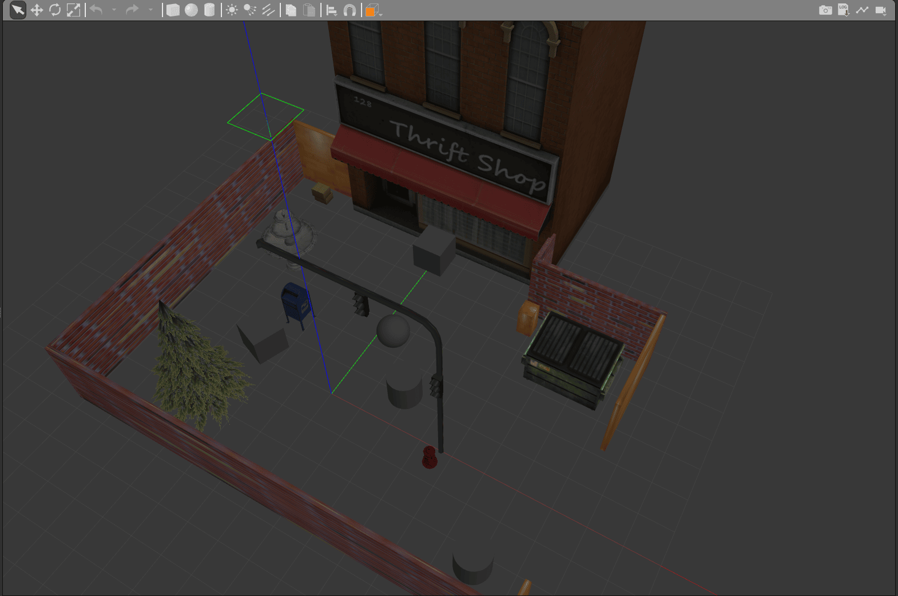

4. **Load the world in the launch file.** Add the world as a launch argument when including the Gazebo launch:
   ```python
   launch_arguments={'world': world_path}.items()
   ```
5. **Install the world directory** in `CMakeLists.txt`, otherwise Gazebo opens an empty world:
   ```cmake
   install(DIRECTORY ..., worlds DESTINATION share/${PROJECT_NAME})
   ```
6. **Build and source**
   ```bash
   cd ~/ros2_ws
   colcon build
   source install/setup.bash
   ```
7. **Launch the simulation.** Gazebo loads the robot and the custom world, RViz2 opens, SLAM Toolbox starts and a teleop terminal opens:
   ```bash
   ros2 launch adv_tortoisebot map_custom_world.launch.py
   ```

   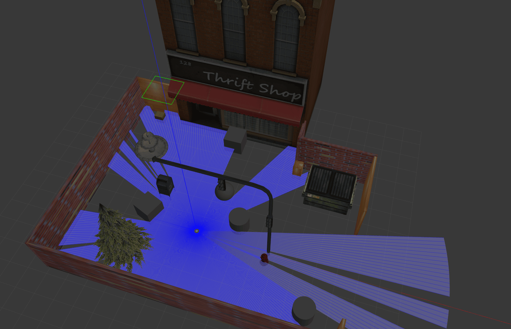

8. **Visualize in RViz.** The RViz display is launched by the same file. Add a **LaserScan** display on the topic `/scan` and check that the rays reflect from all obstacles. Drive the robot with the teleop terminal to explore the world.

   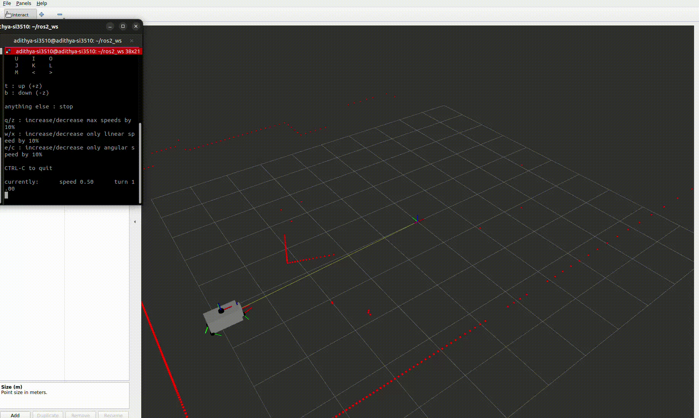

9. **Map the world.** Drive the robot around the whole map with `teleop_twist_keyboard` while SLAM Toolbox builds the 2D map (shown at 8x speed).

   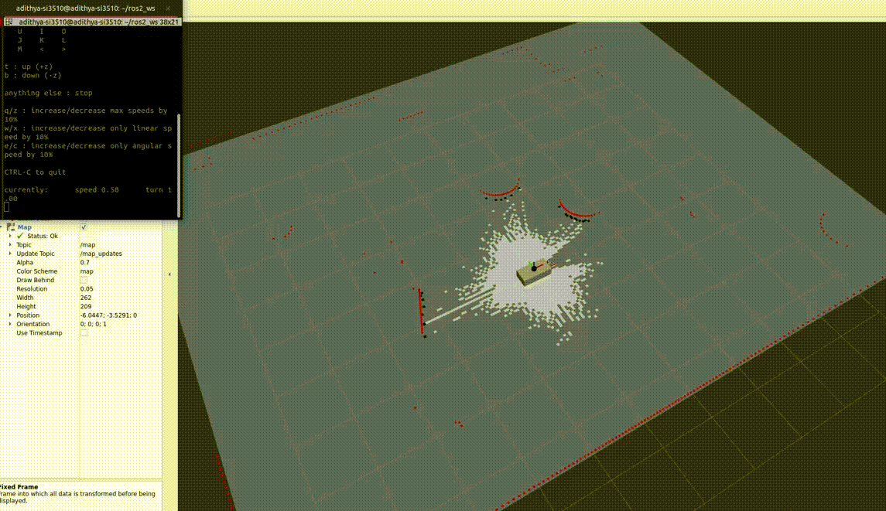

### Result
The TortoiseBot explores the custom world with 10+ obstacles, `/scan` publishes correctly, the LIDAR rays are visible in RViz2 and all obstacles are detected. The generated map is saved:

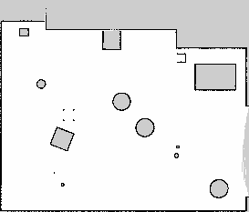

Video: [Mapping of the custom world](https://workdrive.zoho.in/file/dixwuaeb8efa001594df1bcf3cc41381e590e)

### Challenges solved
| Problem | Root cause | Solution |
|---|---|---|
| Gazebo loaded an empty world instead of the custom one. | The `worlds` directory was missing from `install()` in `CMakeLists.txt`. | Added the directory to `install()` and ran `colcon build` again so the world file is copied to `install/`. |

---

## Fuse 2D LIDAR and Depth Camera
Add a depth camera, fuse its data with the 2D LIDAR into one `PointCloud2`, and build a 3D map with OctoMap.

**Launch file:** `fuse_lidar_depth_camera.launch.py`
**Node:** `laser_pt_cloud.py`

### Step-by-step
1. **Reuse the existing workspace** with the Gazebo and RViz launch files and the TortoiseBot model.
2. **Add the depth camera.** A separate `depth_cam.xacro` holds the optical camera link and the depth camera plugin, and is included in `tortoise_bot.urdf.xacro`.

   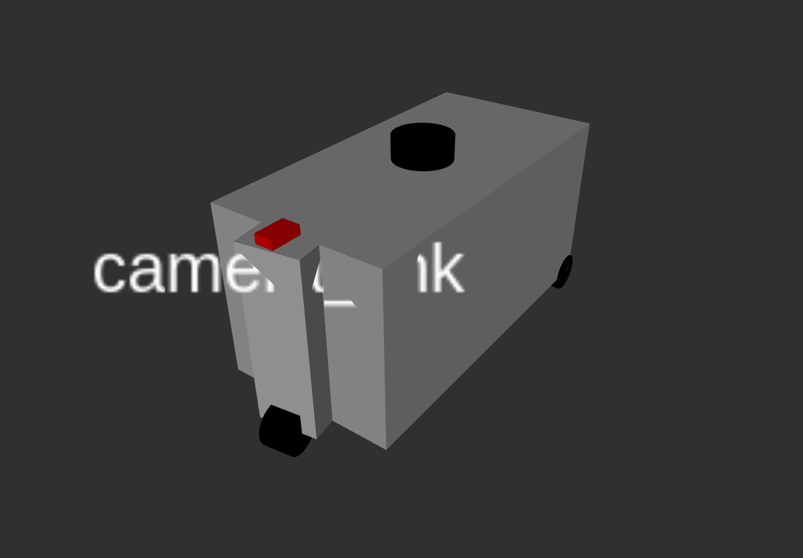

3. **Check both sensors.** With the robot in the custom world, the depth camera point cloud and the LaserScan are both visible in RViz, and the scan lines up with the point cloud.

   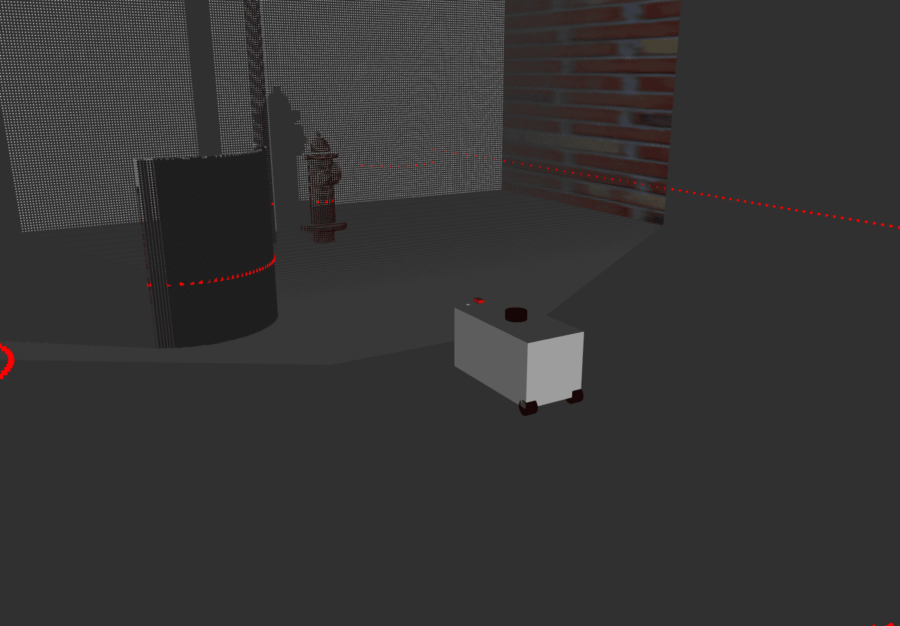

4. **Fuse the sensor data.** The node `laser_pt_cloud.py` needs both inputs as `PointCloud2`:
   - `LaserProjection` (`laser_geometry`) converts `/scan` into a point cloud published on `/laser_point_cloud2`.
   - `sensor_msgs_py.point_cloud2` reads `/laser_point_cloud2` and `/depthcam/points`, adds them together and publishes the result on `/merge_point_cloud2`.

   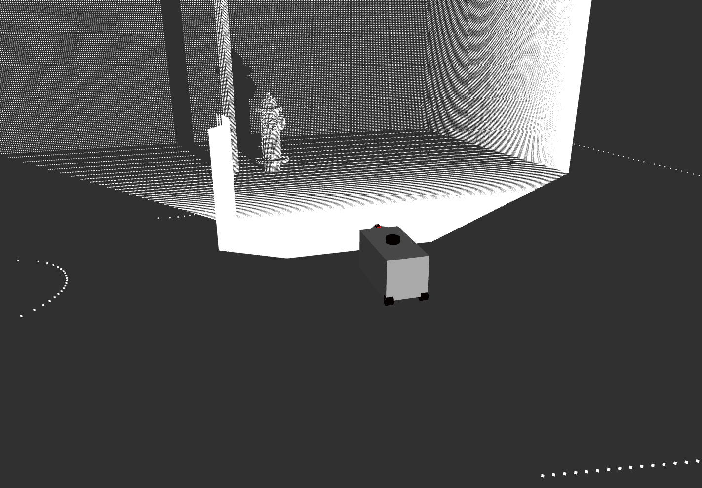

5. **Install OctoMap**
   ```bash
   sudo apt update
   sudo apt install ros-humble-octomap ros-humble-octomap-mapping ros-humble-octomap-server
   ```
6. **Configure OctoMap.** The stock launch is `ros2 launch octomap_server octomap_mapping.launch.xml`. A copy was made in the workspace (`launch/octomap_launch.xml`) with these changes so it uses the merged cloud:
   ```xml
   <param name="frame_id" value="odom" />
   <remap from="cloud_in" to="/merge_point_cloud2" />
   ```
7. **Map in 3D.** Launch Gazebo, RViz, the merge node and the OctoMap launch, then in RViz add a **PointCloud2** display on `/octomap_point_cloud_centers`. Drive the robot with `teleop_twist_keyboard` to build the 3D map.

   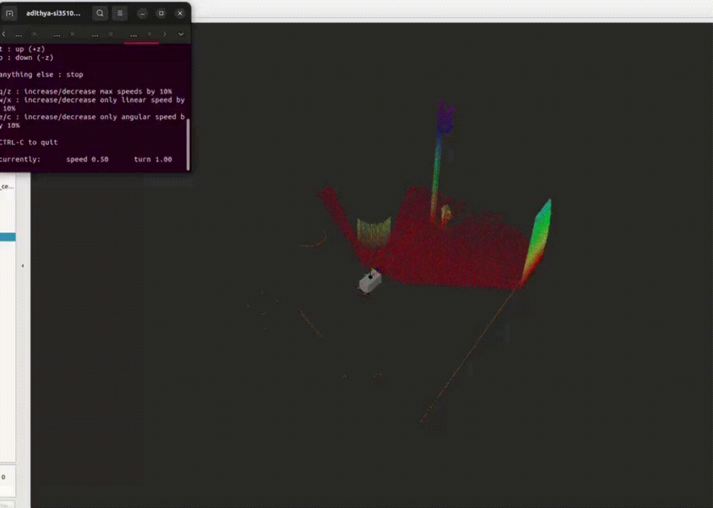

8. **Save the map** in `.bt` format:
   ```bash
   ros2 run octomap_server octomap_saver_node --ros-args -p octomap_path:=map.bt
   ```
9. **Run everything with one launch file.** `fuse_lidar_depth_camera.launch.py` starts Gazebo, RViz2 (`rviz/task5.rviz`), `laser_pt_cloud.py`, SLAM Toolbox localization and an `octomap_server_node` that loads the saved map (`octomap_path: maps/my_octomap.bt`, `frame_id: map`):
   ```bash
   ros2 launch adv_tortoisebot fuse_lidar_depth_camera.launch.py
   ```
   In RViz add a **PointCloud2** display on `octomap_point_cloud_centers` and set **Durability Policy** to **Transient Local**. The map can also be viewed as a **MarkerArray** (`/occupied_cells_vis_array`) with Transient Local.

   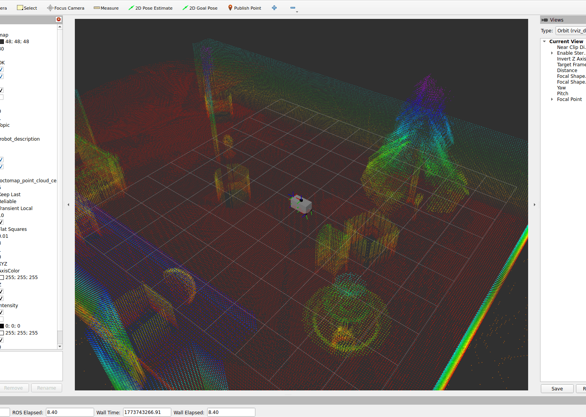

### Result
The mapping succeeds and the 3D point cloud map of the world is generated.

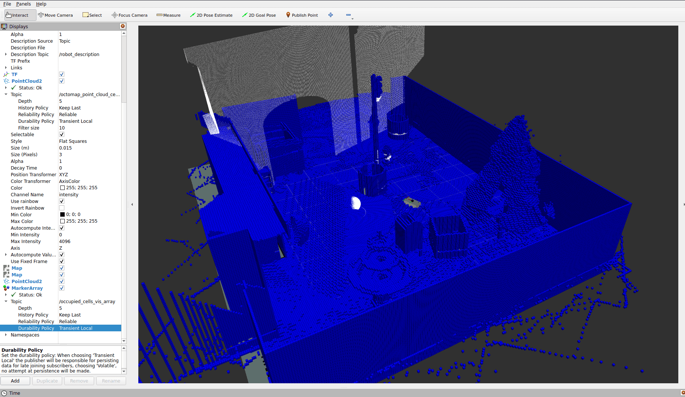

Video: [3D mapping with the fused sensors](https://workdrive.zoho.in/file/er25u765dce6aac3d4758b3328e29659b8435)

### Challenges solved
| Problem | Solution |
|---|---|
| The depth camera point cloud was projected upwards instead of forward. Robotics frames and camera/image frames use different conventions (the camera looks along Z, ROS reads Z as up). | Added an empty `camera_optical_link` parented to `camera_link` (`base_link → camera_link → camera_optical_link`), rotated it by -90° (roll and yaw) and set the depth camera `frame_id` to `camera_optical_link`. |
| During fusion the LIDAR and depth camera frames differed and did not align. | Used `tf2_ros` to look up the transform from the laser frame to the camera frame, transformed the laser cloud into the camera frame, then read it and added it to the camera points. |
| The saved OctoMap (`map.bt`) was not visible in RViz although the topic was publishing. | The cloud is published as Transient Local, so the RViz display durability policy must be set to **Transient Local**. The `octomap_rviz_plugin` can also be used to view the `octomap_binary`. |

---

## Autonomous 2D Navigation
Navigate the TortoiseBot autonomously in the custom world with Nav2, using the saved 2D map and AMCL localization.

**Launch file:** `autonomous_navigation.launch.py`

### Step-by-step
1. **Reuse the existing workspace**: the xacro TortoiseBot with the 2D LIDAR, the custom world and the saved map `maps/map.yaml`.
2. **Configure Nav2** in `config/nav2_params.yaml`:
   - **AMCL:** `base_link` / `odom` / `map` frames, scan topic `/scan`
   - **BT navigator:** global frame `map`, robot base frame `base_link`, odometry `/odom`
   - **Controller:** DWB local planner, max speed 0.26 m/s linear and 1.0 rad/s angular, goal tolerance 0.25 m (xy) and 1.5 rad (yaw)
   - **Planner:** NavFn global planner, tolerance 0.5
   - **Local costmap:** `odom` frame, 0.05 m resolution, robot footprint, voxel layer from `/scan`, inflation layer
   - **Global costmap:** `map` frame, 0.05 m resolution, static + obstacle (`/scan`) + inflation layers
   - **Behavior server:** spin, back up, drive on heading, wait, assisted teleop
3. **Create the RViz config** `rviz/task6.rviz` with the robot model, TF, LaserScan, maps and marker array.
4. **Create the launch file** `autonomous_navigation.launch.py`. It starts:
   - `gazebo.launch.py` (Gazebo and the robot)
   - `rviz2` with `rviz/task6.rviz`
   - `nav2_bringup` `bringup_launch.py` with `map:=maps/map.yaml`, `params_file:=config/nav2_params.yaml` and `use_sim_time:=true`
   - `octomap_server_node` loading `maps/my_octomap.bt` (`frame_id: map`)
5. **Build and source**
   ```bash
   cd ~/ros2_ws
   colcon build
   source install/setup.bash
   ```
6. **Launch the navigation setup**
   ```bash
   ros2 launch adv_tortoisebot autonomous_navigation.launch.py
   ```
7. **Localize and navigate.** In RViz use **2D Pose Estimate** to set the initial pose so AMCL localizes the robot, then use **2D Goal Pose** to send a goal. Nav2 plans a path on the global costmap and the controller drives the robot along it, avoiding obstacles seen by the LIDAR.

### Result
The TortoiseBot localizes on the saved map and navigates to goal poses set in RViz, using Nav2 and the 2D LIDAR for obstacle avoidance. This setup is reused for multi-waypoint navigation.

---

## Multi-Waypoint Navigation
A ROS 2 node sends the robot through 5 predefined waypoints (pit stops) using the Nav2 `NavigateToPose` action. It pauses at each stop for a different time, then returns to the starting position (home).

**Launch file:** `multi_waypoint_navigation.launch.py`
**Node:** `task7waypoint.py`

### Step-by-step
1. **Reuse the 2D navigation setup.** The navigation launch from the previous section is used, and the initial and goal poses are set by a custom node.
2. **Create the node** (`task7waypoint.py`) as a standard `rclpy` `Node`.
3. **Add the interfaces.** The node has an `ActionClient` for `/navigate_to_pose` and a publisher on `/initialpose`.
4. **Publish the initial pose.** A function publishes a `PoseWithCovarianceStamped` to `/initialpose` for localization, **5 times with a 0.5 s delay** between messages.
5. **Add the navigation function.** A function takes a goal pose and runs `NavigateToPose`:
   - wait for the action server
   - create the goal message
   - send the goal
   - wait for goal acceptance and check whether it was accepted or rejected
   - wait for the navigation result
   - read the result (success or failure)
6. **Build the main loop.**
   - set the initial pose (AMCL)
   - define the waypoints and the wait time at each one
   - convert them to `PoseStamped` goals (the initial pose is appended as the final goal, home)
   - run the navigation loop: go to each pose, wait, continue
7. **Launch navigation and simulation.** The launch file starts Gazebo, RViz2 and `nav2_bringup`, then the waypoint node in a new terminal:
   ```bash
   ros2 launch adv_tortoisebot multi_waypoint_navigation.launch.py
   ```
   The initial pose is set, the robot navigates to each waypoint, waits for the given delay and goes home at the end. Check it in RViz.

### Result
The robot passes through 5 predefined waypoints with the `NavigateToPose` action, waits a different time at each, and returns to the home (initial) pose when done.

Video: [Multi-waypoint navigation](https://workdrive.zoho.in/file/acnqtbadacc73844a447baf47344e66857e46)

### Challenges solved
| Problem | Solution |
|---|---|
| The initial pose failed because it was sent before AMCL was online. | The initial pose is published several times with a small delay, so AMCL receives it once it is up. |
| The node failed and skipped goals, missing a few waypoints at the start. | The node must run only after navigation has fully started and is waiting for the initial pose and the `map` frame. A delay after setting the initial pose lets Nav2 get the `map` frame from localization. |
# Mobile_Bot_Advanced
